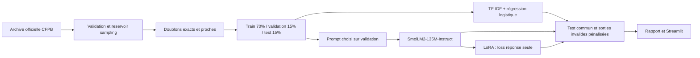

# Fine-tuning et évaluation comparative d’un LLM pour l’analyse des réclamations clients

Projet portfolio exécuté sur Windows, Intel i7-13620H, 16 Go de RAM, Intel UHD, PyTorch CPU. Interface française ; données et modèle évalués **en anglais**. Trois produits CFPB historiques : `Mortgage`, `Debt collection`, `Credit card`. Ce périmètre fermé ne couvre pas toutes les réclamations clients.

Le rapport mesuré se trouve dans [reports/COMPARISON.md](reports/COMPARISON.md). Les résultats bruts sont conservés dans `reports/`, les modèles réellement entraînés dans `artifacts/`. Ne pas présenter un adaptateur smoke comme une amélioration de qualité.

Exécutions vérifiées le 13 octobre 2026 : LoRA complet, trois epochs et 315 étapes sur CPU ; baseline classique 91,1 % d’accuracy, LLM de base 0 % au contrat JSON strict, LoRA 80 % et 100 % de JSON conformes sur 45 récits. Les 13 tests finaux passent sans skip, ainsi que Ruff. Aucun entraînement nécessaire n’est bloqué ; Colab et la CI distante ne sont pas exécutés.

Autres livrables : [fiche modèle](MODEL_CARD.md), [explication pédagogique](docs/PEDAGOGIE.md), [démo cinq minutes](docs/DEMO_5_MIN.md), [trois puces CV](docs/CV.md), [notebook Colab](notebooks/colab.ipynb) et [analyse d’erreurs](reports/ANALYSIS.md).

## Démarrer

Après installation et entraînement avec les commandes ci-dessous, depuis la racine du dépôt :

```powershell
& .\.venv\Scripts\python.exe -m streamlit run app.py --server.address 127.0.0.1
```

## Installation reproductible dans une nouvelle copie

Python 3.12 et accès Internet requis. L’exécution de référence a utilisé un environnement Python isolé sur Windows. Aucun compte, secret ou service payant nécessaire.

Windows PowerShell, à la racine de ce projet :

```powershell
py -3.12 -m venv .venv
& .\.venv\Scripts\python.exe -m pip install -r requirements-lock.txt
& .\.venv\Scripts\python.exe -m pip install --no-deps -e .
& .\.venv\Scripts\python.exe -m complaints.cli prepare
& .\.venv\Scripts\python.exe -m complaints.cli classic
& .\.venv\Scripts\python.exe -m complaints.cli prompt
& .\.venv\Scripts\python.exe -m complaints.cli smoke
& .\.venv\Scripts\python.exe -m complaints.cli full
& .\.venv\Scripts\python.exe -m complaints.cli evaluate --adapter adapter_full
& .\.venv\Scripts\python.exe -m streamlit run app.py --server.address 127.0.0.1
```

Linux :

```bash
python3.12 -m venv .venv
source .venv/bin/activate
pip install -r requirements-lock.txt
pip install --no-deps -e .
python -m complaints.cli prepare
python -m complaints.cli classic
python -m complaints.cli prompt
python -m complaints.cli smoke
python -m complaints.cli full
python -m complaints.cli evaluate --adapter adapter_full
streamlit run app.py --server.address 127.0.0.1
```

`--limit 3` évalue les trois premiers exemples de chaque classe du test, identiques pour tous les modèles. Sans limite, tout le test est utilisé. Le choix du prompt est exclusivement fait sur six exemples de validation ; égalité départagée par le premier prompt. Ne pas réoptimiser après consultation du test. Une nouvelle expérience nécessite un protocole préétabli et un nouveau test.

```powershell
$env:RUN_LLM_TESTS = "1"
& .\.venv\Scripts\python.exe -m pytest -q
& .\.venv\Scripts\python.exe -m ruff check .
& .\.venv\Scripts\python.exe -m complaints.cli infer --kind lora --adapter adapter_full --text "My mortgage payment was charged twice."
```

## Architecture



## Données et droit d’utilisation

Source primaire : [archive CFPB](https://www.consumerfinance.gov/foia-requests/foia-electronic-reading-room/cfpb-consumer-complaint-database-narratives-archive/), récits décembre 2011–avril 2018. La [publication officielle d’août 2026](https://www.consumerfinance.gov/about-us/newsroom/the-cfpb-to-cease-discretionary-publication-of-complaint-narratives-and-visualizations/) explique l’arrêt de publication et considère les récits antérieurement publiés comme du domaine public pour les besoins FOIA. Cela n’équivaut pas à une garantie d’absence de données personnelles ni à une licence des miroirs tiers. Les récits sont des allégations non vérifiées. Le CFPB retirait les informations directement identifiantes avant publication ; du contenu sensible peut subsister. Seuls texte, étiquette et identifiant sont conservés dans les partitions locales, sans nom de société ni code postal ajouté.

Recherche française : le [baromètre DGCCRF](https://www.data.gouv.fr/datasets/barometre-des-reclamations-depuis-2008-repartition-des-plaintes-par-secteur) fournit des statistiques agrégées, pas les textes étiquetés nécessaires. Aucune source française adaptée n’a été confirmée dans cette recherche limitée. Ce projet ne valide donc pas la langue française et ne traduit pas silencieusement les récits.

Le téléchargement officiel est automatisé et vérifié comme ZIP ; SHA-256 sauvegardé. Échantillonnage reservoir borné à 100 textes par classe, graine 42, après exclusion des récits absents ou inférieurs à 80 caractères. Nettoyage : espaces seulement. Les catégories gardent exactement les libellés historiques CFPB, sans fusion avec les nouvelles taxonomies.

Déduplication avant split : normalisation casse/ponctuation, puis composantes connexes de similarité TF-IDF caractères 3–5, cosinus ≥0,90. Un représentant par composante, y compris entre classes. Détection heuristique, pas garantie d’absence de paraphrases. `data/manifest.json` contient effectifs, exclusions, distributions, longueurs, empreintes et splits. La vectorisation de similarité utilise tout l’échantillon pour contrôler les fuites ; la TF-IDF prédictive est ajustée uniquement sur train.

Politique LLM : le début du récit est limité à 160 tokens AVANT application du chat template natif. Les instructions et la réponse cible ne sont pas tronquées. Cela peut supprimer un fait décisif en fin de récit. La baseline classique lit tout le texte : avantage méthodologique explicite. Base et LoRA voient exactement le même texte tronqué, prompt et génération greedy, maximum 100 tokens. Le test est réservé à l’évaluation finale.

## Modèle et apprentissage

[SmolLM2-135M-Instruct](https://huggingface.co/HuggingFaceTB/SmolLM2-135M-Instruct), Apache-2.0, choisi pour permettre CPU float32 sans quantification. Révision effective figée après premier chargement dans `artifacts/model_revision.json`. LoRA : `q_proj`, `v_proj`, rang 8, alpha 16, dropout 0,05 ; nombre exact de paramètres dans `run.json`. Batch 1, accumulation 2, LR 3e-4 ; smoke 3 étapes, complet 3 epochs. Les checkpoints sont sauvegardés avec limite de conservation 2. La loss ignore les tokens du prompt (`-100`). Les cibles viennent exclusivement des classes du dataset : résumé et justification `null`, sans annotation inventée.

La loss d’entraînement et de validation, durée et RSS finale sont mesurées ; la RSS finale n’est pas une mesure du pic mémoire. Pas de QLoRA, bitsandbytes ou prétendu GPU Intel. L’app charge puis libère chaque modèle séquentiellement. Chargement exclu des latences du rapport, inclus dans le temps utilisateur réel.

## Évaluation et démonstration

Accuracy, macro-F1 sur classes métier, précision/rappel/F1 par classe, matrice avec colonne échec, validité syntaxique JSON et validité du schéma sont séparés. JSON strict : pas de réparation implicite. Une réponse invalide compte comme mauvaise classification. Greedy, batch 1, perf_counter, une chauffe sur validation exclue ; médiane et p95 conservés. Petit test : forte incertitude, pas de généralisation bancaire ou française.

La grille `reports/human_rubric.csv` évalue **séparément** fidélité, pertinence, absence d’invention et concision, notes 1–5 : 1 = défaut majeur, 3 = acceptable avec défauts, 5 = pleinement satisfait. Champs null = indisponibles, jamais notés comme bons résumés. Lire le texte complet pour repérer les omissions dues à la troncature. Faire annoter en aveugle par deux personnes, puis discuter les désaccords. Aucune évaluation humaine prétendue déjà réalisée.

L’interface accepte `demo.csv`, exporte CSV/JSON, affiche les sorties brutes invalides, signale l’absence d’adaptateur et conserve un seul LLM en mémoire. Les exemples de `demo.csv` sont des entrées illustratives rédigées pour la démonstration, jamais utilisées pour entraîner ou évaluer les scores réels.

Le notebook `notebooks/colab.ipynb` offre la procédure GPU gratuite, non exécutée dans cette session. Aucune publication externe effectuée. Avant publication GitHub, contrôler les rapports d’erreurs contenant du texte réel et ne pas inclure `data/` ou `artifacts/` ; ils sont ignorés par Git. Les commandes GitHub CI sont préparées, pas présentées comme une CI distante exécutée.

Documentation officielle consultée : [Transformers chat templates](https://huggingface.co/docs/transformers/chat_templating), [PEFT LoRA](https://huggingface.co/docs/peft/en/package_reference/lora), [Datasets loading](https://huggingface.co/docs/datasets/loading), [scikit-learn](https://scikit-learn.org/stable/modules/generated/sklearn.linear_model.LogisticRegression.html), [Streamlit AppTest](https://docs.streamlit.io/develop/api-reference/app-testing/st.testing.v1.apptest).

Pour produire le ZIP source destiné à GitHub ou Colab : `python scripts/package.py`. L’archive est créée à côté du dossier projet et exclut les données, adaptateurs et exemples d’erreurs contenant les récits. La répétition locale de CI (`reports/ci_local_check.json`) utilise un environnement sans PyTorch ; elle ne prouve pas une exécution sur GitHub. Le pic RSS dans `reports/training_resources.json` est échantillonné toutes les cinq secondes à partir d’une partie du run complet, donc reste une borne inférieure du pic réel.

Pour reconstruire les graphiques depuis les historiques sauvegardés : `python scripts/plot_training.py`. Le rapport détaillé de cette exécution peut être reconstruit avec `python scripts/build_report.py` à partir des mesures dans `reports/` et des historiques originaux. Les partitions et l’environnement de cette exécution sont également conservés dans les rapports ; ne pas mélanger ces mesures avec un nouvel entraînement.
