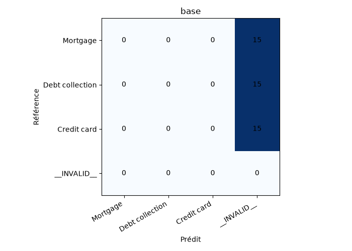
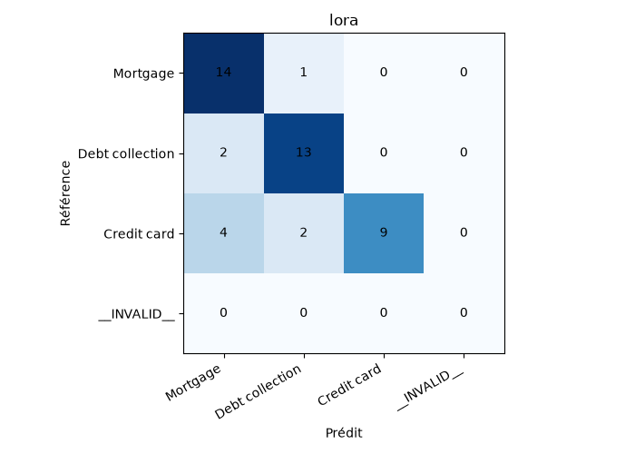
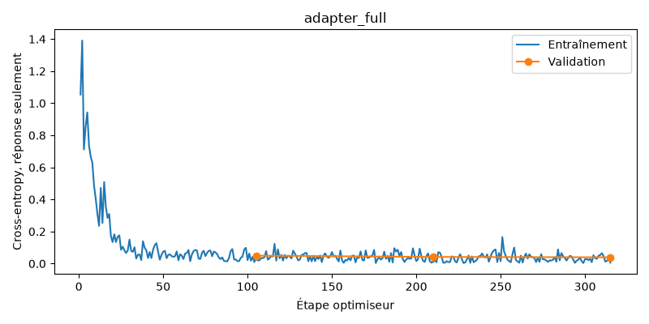

# Rapport comparatif mesuré — 13 octobre 2026

300 récits CFPB réels en anglais ; trois catégories équilibrées. Train 210, validation 45, test 45.
Le prompt est choisi sur six exemples de validation, jamais sur le test. La comparaison finale utilise
les mêmes 45 récits, le même prompt et la même génération pour les deux LLM.

Matériel : Intel i7-13620H, Intel UHD sans CUDA, 15.7 Gio RAM, CPU float32, quatre threads.
Python 3.12.14, PyTorch 2.14.1+cpu. Batch 1, perf_counter, chauffe sur validation exclue ; chargement exclu.

| Approche | Accuracy | Macro-F1 | JSON parsable | Schéma conforme | Latence médiane (s) | p95 (s) |
|---|---:|---:|---:|---:|---:|---:|
| classic | 0.911 | 0.910 | 1.000 | 1.000 | 0.0013 | 0.0023 |
| base | 0.000 | 0.000 | 0.000 | 0.000 | 9.0363 | 9.4833 |
| lora | 0.800 | 0.796 | 1.000 | 1.000 | 2.9691 | 3.1388 |

La baseline classique reste meilleure sur ce test. Le LLM de base échoue au contrat JSON :
ses 45 sorties invalides comptent comme échecs. LoRA rétablit le format mais commet neuf erreurs
de catégorie. Un score nul du pipeline de base ne mesure pas séparément sa compréhension sémantique.

Les textes sont tronqués à 160 tokens pour les deux LLM ; la baseline classique lit tout le récit.
172 récits sur 300 sont concernés par cette troncature. La latence dépend aussi de la longueur
effectivement générée et de l’arrêt EOS ; elle ne prouve pas une accélération intrinsèque de LoRA.

## Résultats par classe

| Modèle | Classe | Précision | Rappel | F1 | Support |
|---|---|---:|---:|---:|---:|
| classic | Mortgage | 0.929 | 0.867 | 0.897 | 15 |
| classic | Debt collection | 0.938 | 1.000 | 0.968 | 15 |
| classic | Credit card | 0.867 | 0.867 | 0.867 | 15 |
| base | Mortgage | 0.000 | 0.000 | 0.000 | 15 |
| base | Debt collection | 0.000 | 0.000 | 0.000 | 15 |
| base | Credit card | 0.000 | 0.000 | 0.000 | 15 |
| lora | Mortgage | 0.700 | 0.933 | 0.800 | 15 |
| lora | Debt collection | 0.812 | 0.867 | 0.839 | 15 |
| lora | Credit card | 1.000 | 0.600 | 0.750 | 15 |

## Conformité et matrices

Les matrices incluent une colonne INVALID. Les sorties rejetées ne sont jamais retirées du dénominateur.

### classic

Catégorie non autorisée dans un JSON parsable : 0.0% ; réponse vide : 0.0% ; sortie inexploitable : 0.0%.
Une réponse non JSON ne permet pas de compter une catégorie extraite ; elle reste un échec global.

### base

Catégorie non autorisée dans un JSON parsable : 0.0% ; réponse vide : 0.0% ; sortie inexploitable : 100.0%.
Une réponse non JSON ne permet pas de compter une catégorie extraite ; elle reste un échec global.

### lora

Catégorie non autorisée dans un JSON parsable : 0.0% ; réponse vide : 0.0% ; sortie inexploitable : 0.0%.
Une réponse non JSON ne permet pas de compter une catégorie extraite ; elle reste un échec global.

## Apprentissage et ressources

LoRA complet effectivement exécuté : trois epochs, 315 étapes, 2108.5 s (35.1 min).
460,800 paramètres entraînables sur 134,975,808 paramètres au total ; q_proj/v_proj, r=8, alpha=16, dropout=0,05.
LR 3e-4, batch 1, accumulation 2, loss sur la complétion seulement. Les cibles sont la catégorie et deux champs null, sans références inventées.
L’adaptateur smoke exécute trois étapes seulement ; il ne constitue pas une preuve de performance.

Loss de validation : 0,04995 à epoch 1 ; 0,04158 à epoch 2 ; 0,03942 à epoch 3.
Pic RSS échantillonné : environ 1,45 Gio ; échantillonnage cinq secondes commencé en cours de run, donc borne inférieure du pic réel. Pas de VRAM CUDA utilisée.

## Erreurs et qualité des textes

[Analyse qualitative](ANALYSIS.md) : quatre erreurs classiques et neuf LoRA, avec identifiants réels et hypothèses explicitement distinguées des faits.
Les extraits et sorties brutes sont dans ERROR_EXAMPLES.md et predictions_*.json, conservés localement et exclus de l’archive source.
La grille human_rubric.csv contient une ligne séparée pour chaque résumé et justification. Aucune note humaine attribuée ; les champs null ou sorties invalides sont indisponibles.
Il n’y a aucune validation de fidélité, pertinence ou absence d’hallucinations des résumés et justifications. Aucun score ROUGE inventé.

## Vérifications et limites

13 tests pytest locaux réussis, sans skip : données, parsing, échecs, CSV, baseline, rechargement des deux adaptateurs entraînés et comparaison Streamlit. Ruff passe.
Répétition de CI sans PyTorch ni dataset : six tests passent, sept tests d’intégration sont ignorés. GitHub Actions est préparé, pas exécuté sur un compte distant.
Le serveur Streamlit local répond HTTP 200. Le parcours CSV teste les fonctions réellement partagées avec l’interface ; aucune automatisation du clic sur le sélecteur de fichier du navigateur n’est prétendue.
Limites : test de 45 exemples, trois produits financiers historiques, labels consommateur bruités, échantillon équilibré artificiellement, troncature et aucune validation française. Pas de conclusion statistique générale ni de comparaison avec les grands LLM.
Colab préparé, non exécuté ; aucune ressource payante créée. Aucun dépôt, dataset ou modèle publié sur un compte externe.
